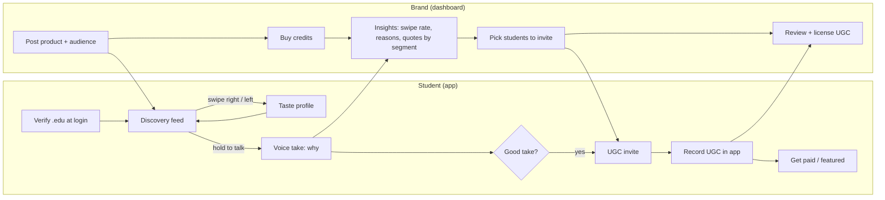

# REAL: verified students swipe on products, brands get the why (and the UGC)

YC Consumer Mobile Hackathon, Nov 15, 2026. Team: Shri + Vishnu.

> **Brands are flying blind on Gen Z.** Surveys get bots, focus groups cost $10k and take weeks, and UGC creators are found by cold DM. REAL is a **Pinterest-style discovery feed for verified college students**: you scroll products you'll probably like, swipe right or left, and **hold to talk** to say why. Brands get verified Gen Z reactions with reasons attached, and the students who give the best reasons get invited to **make paid UGC** for the brand. That's where brands spend their **UGC credits**.

- **Product spec (this file):** the whole idea from both sides, then the hackathon cut.
- **Build plan, lanes, API contract:** [`docs/TASKS.md`](docs/TASKS.md) (still written for the clip-reaction version; see [What's built vs. this spec](#whats-built-vs-this-spec)).
- **Agent rules:** [`AGENTS.md`](AGENTS.md) · **Commands:** [`docs/COMMANDS.md`](docs/COMMANDS.md) · **Env/secrets:** [`docs/ENV.md`](docs/ENV.md)

---

## 1. The idea in one loop

Students come for the feed (it's fun to scroll, and it learns what they like). Brands come for what the feed produces: **verified demographic signal** (swipes), **qualitative signal** (voice reasons), and **content** (UGC from people who already said they like the product).

## 2. Student side

### 2.1 Who and why they open it
- **Who:** college students first, verified at login. Later: other verified cohorts (new grads, specific schools, majors, Greek life, athletes) because "verified segment" is what brands pay for.
- **Why they open it daily:**
  1. **The feed itself.** Pinterest's "more ideas like this," but for things to buy and try: snacks, skincare, apps, gear, clothes, dorm stuff, local spots. Endless, personalized, and it drifts into adjacent things you didn't know you'd like.
  2. **Free stuff and money.** Good voice takes unlock UGC gigs (cash), product drops (free samples), and early access.
  3. **Identity.** A shareable Taste profile ("you're 40% thrift, 30% gym, 30% matcha") and a "taste-maker" score that shows brands listen to you.

### 2.2 Onboarding and verification
1. Enter a `.edu` email → 6-digit code → verified. Store school, grad year, and verification time. (Later: SheerID/UNiDAYS-style verification for schools without `.edu`, plus a periodic re-verify.)
2. Pick 5+ interest tiles to seed the feed (cold start).
3. Optional profile: major, city, gender, age bracket. Every field is optional and each one is labeled "brands see this only in aggregate."
4. Mic permission is asked **the first time they hold the talk button**, not at onboarding.

One account per verified email and device. The verified badge is the product: brands pay for "real verified students," so the badge has to be hard to fake.

### 2.3 The discovery feed
- **Card:** a big product image or short video, brand name, one line of copy, price, and a small "Sponsored" tag on paid placements. Tap → detail (more media, where to buy).
- **Swipe right** = "I'd use this." **Swipe left** = "not for me." **Swipe up / tap ♥** = "save." Every swipe records dwell time before the swipe; a fast swipe counts less than a considered one.
- **Hold to talk** (big mic button on every card): hold, say why you do or don't like it, release. A 3–20 second clip. The voice agent:
  - transcribes it and pulls out **sentiment, reasons** (price, taste, look, trust, "my roommate has it"), **purchase intent**, and **one quotable line**;
  - sometimes asks **one** short follow-up out loud or on screen ("Would you pay $4 for it?" / "What would make you switch from Celsius?"), and only when the take was vague or the brand asked a question;
  - scores the take's quality (specific, honest, articulate). Quality drives UGC invites, never sentiment: a sharp "this is overpriced and here's why" is worth as much to the brand as praise.
- **Face reactions on video cards (opt-in):** when a card is a video (an ad, a product demo, a skit), the student can turn on "react mode." The front camera runs on-device face detection (the MediaPipe laugh detector already in the app) only while that video plays, and records a reaction curve: smiles, laughs, and whether their face stayed on screen. No video leaves the phone, only scores and timestamps. It also proves a real person watched, which makes the student's swipe and take on that card count as a **verified-attention** response (worth more points, and billed as a premium response to the brand).
- **Feed mix (the Pinterest part):** each session interleaves
  - ~60% **exploit:** products close to your taste vector,
  - ~25% **adjacent:** neighbors of things you swiped right ("people who liked this oat milk also liked this tote bag"), which is what makes the feed feel like discovery,
  - ~15% **explore + campaign fill:** brand campaigns that still need responses from your segment, plus random categories to keep the profile from collapsing.
- Paid campaigns get **guaranteed impressions within their target segment**, but they're ranked inside the same feed so the feed never feels like an ad wall. A campaign that's a terrible match for you isn't shown to you, even if it's paid.

### 2.4 Rewards and UGC
- **Points per action** (swipe = small, voice take = more, high-quality take = most) roll into levels. Levels unlock product drops and higher-paying gigs. Points are not cash, to avoid paying for spam swipes.
- **UGC invite:** when a student leaves a high-quality take on a product whose brand has UGC credits, the brand (or auto-match) can invite them. The invite shows the brief, the payout (or "featured in-app, no cash" for unpaid community content), the deadline, and usage rights.
- **Making the content:** record in-app (front or back camera, 15–60s) or upload. The brief stays visible as a teleprompter-style checklist. A free product can be shipped first for physical goods.
- **Review:** the brand approves, requests one revision, or declines with a reason. Approved = paid to the wallet and licensed to the brand.
- **Unpaid UGC:** students can also just post a take publicly in the app (a "review reel"). The best ones surface to brands, and that's the farm system for paid gigs.
- **Wallet:** balance, history, cash out (Whop payouts), plus streaks.

### 2.5 What students never get
No raw audio shared without consent (brands see transcripts and quotes by default; raw audio only for takes the student marks "OK to share my voice"). No name attached to a take unless the student accepts a UGC invite. No paying for positive opinions: payment and points are the same for love or hate.

## 3. Brand side

### 3.1 Who and why
DTC brands, CPG challengers, apps, and agencies who sell to 18–24-year-olds and need two things they currently buy separately: **"will Gen Z like this and why"** (research) and **"people who can make content that looks native"** (UGC). REAL sells both from one pool of verified students, and the research step *finds* the creators.

### 3.2 Brand flow
1. **Sign up** with a work email; first campaign gets free starter credits.
2. **Create a campaign:** product name, images or video, price, link, category tags, and optionally a **question** for the voice agent to ask ("Would you buy this over Liquid Death?"). AI suggests tags and a target segment.
3. **Target:** schools, regions, grad years, interests, and taste clusters ("matcha + thrift + gym"). Show the estimated reach and time to N responses.
4. **Buy credits** (Whop checkout):
   - **Reaction credits:** 1 credit = 1 verified swipe in your target segment. A voice take costs more (e.g., 5 credits) because it's rarer and richer.
   - **UGC credits:** 1 credit = 1 approved, licensed piece of UGC. The price is set per tier (e.g., raw selfie video vs. edited), and the student's payout is shown up front.
5. **Watch results live:**
   - **Right-swipe rate** overall and by segment (school, year, gender, taste cluster), with sample sizes and confidence bars.
   - **Reaction curve** for video creatives: where verified students smiled or laughed second by second, where faces left the screen, and the A/B comparison between two cuts (the curve, A/B, and projector views already built carry over here).
   - **Why:** AI-clustered reasons ("too sweet" 31%, "love the can" 22%), each with real quotes and playable clips where shared.
   - **Versus benchmarks:** your category's average right-swipe rate.
   - **Head-to-head:** run two variants (packaging A vs. B, price $3 vs. $4) as two campaigns and compare.
   - **AI brief:** 3–5 bullets ("Lead with the flavor, not the caffeine. Price objection is concentrated at $4+.").
6. **Pick creators:** a ranked list of students who left high-quality takes, with their take, quality score, and taste profile (anonymized until they accept). Invite them with a brief and a UGC credit.
7. **Review UGC:** approve, request a revision, or decline. On approval: payout fires, the brand downloads the file, and a usage-rights license (term, channels, paid-ads yes/no) is recorded.

### 3.3 What brands can't do
Contact students outside the app, see personal info before a student accepts an invite, buy positive reviews, or target by protected attributes. FTC disclosure (`#ad` / "paid partnership") is attached to every paid UGC deliverable by default.

## 4. Recommendation engine
- **Item representation:** each product gets an embedding from its image + title + description + tags (one multimodal embedding call at creation), plus learned item-to-item co-swipe signal as data accumulates.
- **User representation:** a taste vector = recency-weighted average of right-swiped items minus left-swiped items, plus onboarding interests for cold start, plus reasons extracted from voice takes ("loves anything matcha," "hates neon packaging") stored as memory (Supermemory).
- **Ranking:** `score = similarity(user, item) + adjacency bonus + campaign pacing boost − fatigue (same brand/category recently) + exploration noise`. Campaigns have pacing so a big budget can't flood one person's feed.
- **Quality and fraud signals:** swipes under ~400ms, identical swipe patterns, and voice takes that don't mention the product are down-weighted and don't count toward billed credits. Brands only pay for **valid** responses.

## 5. Economics (hypotheses to test, not decided)
| | Brand pays | Student gets | REAL keeps |
|---|---|---|---|
| Verified swipe | ~$0.10 | points | ~$0.10 |
| Voice take | ~$1.00 | ~$0.25 in points or cash at higher levels | ~$0.75 |
| UGC video (licensed) | ~$75–150 | ~$40–100 | ~30–40% |

Students are "paid" mostly in points and drops for swipes and takes so the feed isn't farmed; cash goes to UGC, where the work is real. Supply-side cost per verified student is near zero because the feed is the reward.

## 6. Trust, safety, and privacy
- **Verification:** `.edu` email + device binding; re-verify each semester; ban on duplicate accounts.
- **Camera:** on only during a video card the student chose to react to, never in the background. Face detection runs on the phone; only scores and timestamps are uploaded.
- **Voice:** recorded only while the button is held; never in the background. Raw audio is kept only if the student opts in to share it; otherwise only the transcript and extracted fields are kept.
- **Honesty incentives:** identical rewards for positive and negative takes. Quality scoring rewards specificity, not sentiment.
- **Brand safety:** product review before campaigns go live (no vapes, gambling, alcohol to under-21s, etc.).
- **UGC rights:** a clear license per deliverable; the student keeps the right to show it in their portfolio.

## 7. Metrics that matter
- **Students:** D1/D7 retention, swipes per session, % of sessions with a voice take, take quality, UGC invite → accept → approved rate.
- **Brands:** time to N verified responses, repeat campaign rate, credits bought per brand, UGC approval rate.
- **Marketplace:** valid-response rate (fraud filter), feed relevance (right-swipe rate on non-campaign items).

---

## 8. Hackathon cut (what we demo at 17:00)

The full vision is above. For today, one loop on two phones:

1. **Student phone:** onboard with a `.edu` email (domain check; the verified badge is shown for `.edu` addresses, with no email code yet) → the feed of product cards → swipe right/left → **hold to talk** on one card → transcript + extracted reasons appear → "You've been invited to make UGC for Brand X" → record a 15s clip → submitted.
2. **Brand phone/laptop:** create a campaign (photo, name, price, question) → pay credits with **Whop** → live dashboard: right-swipe %, reasons with quotes, the student's take → **Invite** → approve the UGC → student wallet goes up.
3. **Optional sponsor flourish:** a brand texts a product photo to the **Keiki** iMessage agent to launch a campaign and gets results texted back.

If there's time, react mode on one video card: the existing laugh detector records a curve, and the brand dashboard shows it with the existing curve component.

Must-haves for the demo: seeded catalog of ~40 products across 8 categories (so the feed feels like Pinterest, not 3 cards), swipe gestures, hold-to-talk with transcription + structured extraction, the brand insights screen, and the invite → UGC → approve → paid path.

Cut for today: real email codes, campaign targeting beyond school/interest, embeddings-based ranking (use tag overlap with the taste profile instead), revision requests, rights contracts, and benchmarks.

### Proposed Convex shape (additive to the current schema)
- `users` += `email?`, `school?`, `verified?`, `interests?`, `role?` ("student" | "brand"), `points?`, `tasteSummary?`.
- `products` (new): `brandId, name, imageStorageId | videoStorageId, price?, link?, tags[], question?, status, isCampaign, creditsLeft`.
- `reactions` (kept): attach to video product cards for react mode (`productId` instead of `gigId`, or keep gigs as video campaigns).
- `swipes` (new): `productId, userId, dir ("right"|"left"|"save"), dwellMs, valid`.
- `takes` (new): `productId, userId, transcript, sentiment, reasons[], quote, intent, quality, audioStorageId?, shareAudio`.
- `ugcInvites` (new): `productId, brandId, userId, takeId, brief, payoutCents, status ("invited"|"accepted"|"submitted"|"approved"|"declined"), videoStorageId?`.
- `credits` / ledger: brand purchases (Whop) and spends.
- Queries/actions: `feed.next({userId})`, `swipes.record`, `takes.submit` (action: speech-to-text + LLM extraction), `campaigns.create`, `campaigns.insights({productId})`, `ugc.invite / accept / submit / approve`.

Voice in Expo Go: record with `expo-audio` (included in Expo Go; `npx expo install expo-audio`), upload the file to Convex storage, transcribe + extract in a Convex action (OpenAI). No custom native modules.

---

## What's built vs. this spec

The repo today is the earlier REAL concept: **creators upload a short clip, reactors watch it with the front camera on, on-device face detection records a laugh curve, reactors get paid per valid view.** It's all on `main` (PRs #1–#13 merged; one unmerged branch, `lane-b/drop-feed`).

| Area | Built today | Reusable for this spec? |
|---|---|---|
| Expo app (SDK 58, Expo Router, native tabs React/Create/Wallet), `@/ui` design system, icon/splash | ✅ | ✅ as is; rename tabs to Discover / Brand / Wallet |
| Name-only onboarding + device session (`users.create`, AsyncStorage) | ✅ | ⚠️ needs `.edu` email + verified flag + interests |
| Convex schema: `users`, `gigs`, `reactions` | ✅ | ⚠️ gigs ≈ campaigns, but no products catalog, swipes, takes, UGC invites, or credits |
| Creator upload (video picker → Convex storage → `gigs.create/publish`) | ✅ | ✅ becomes "brand creates campaign" (add image support) |
| Reactor feed (list of gigs, tap to watch) | ✅ plain list | ❌ no swipe cards, no ranking, no recommendation |
| Watch + on-device laugh detection (MediaPipe in WebView), laugh curve | ✅ proven on iPhone | ✅ becomes opt-in "react mode" on video cards and the verified-attention signal |
| Results dashboard: live curve, A/B compare, stage/projector mode | ✅ | ⚠️ layout reusable; metrics must change to swipe % + reasons + quotes |
| Wallet: balance, history, streaks, cash-out button (disabled until `payments.cashout` exists) | ✅ | ✅ |
| Keiki iMessage agent HTTP tools (`/keiki/gig`, `/keiki/results`, `/keiki/status`) | ✅ | ✅ re-point at campaigns |
| Revyl config + core-flow E2E test | ✅ | ⚠️ test must follow the new flow |
| Whop checkout + payouts (`payments.*`, `/whop/webhook`) | ❌ not started | needed for credits |
| AI report (`report.forGig`) | ❌ not started | becomes the brand "AI brief" |
| Taste profile / Supermemory (Lane T) | ❌ not started (spec only in TASKS.md) | core of the feed now |
| Voice / hold-to-talk, transcription, extraction | ❌ | core |
| `.edu` verification | ❌ | core |
| Swipe feed, product catalog + seed data | ❌ | core |
| UGC invite → record → approve → pay | ❌ | core |
| Daily Drop image feed (`lane-b/drop-feed`, unmerged) | 🟡 branch only | ➖ superseded |

**Net:** the plumbing (Expo + Convex + uploads + wallet + design system + Revyl + Keiki) carries over. Everything that makes this idea different (verified students, swipe feed, voice agent, brand insights, UGC pipeline, credits) still has to be built.

## Sponsors
| Sponsor | Role in this version |
|---|---|
| **Convex** (required) | catalog, swipes, takes, campaigns, live brand dashboard, wallet |
| **Capy** (required) | builds screens and backend pieces from task specs |
| **Revyl** (required) | every PR built and checked on a cloud iPhone |
| **Whop** | brands buy reaction/UGC credits; students cash out |
| **Keiki** | brands launch campaigns and get results over iMessage |
| **Supermemory** | per-student taste memory from swipes and voice reasons |
| **OpenAI** | transcription, reason extraction, take quality, AI brief |
