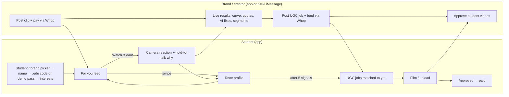

# REAL: verified Gen Z reactions + the why, before you post or launch

YC Consumer Mobile Hackathon, Nov 15, 2026. Team: Shri + Vishnu. (Pivoted at 10:45 from OPEN MIC after judge feedback: "zero impact"; the judges suggested a niche UGC marketplace.)

> **Brands and creators are flying blind on Gen Z: bots inflate every metric, and AI fakes every testimonial.** Test your ad, product video or post on **verified students** first: their faces prove they watched, their voices say why. Students use REAL as a **For you feed that learns their taste**: they swipe on clips, react on camera and get paid. Once the feed knows them, they unlock **paid UGC jobs picked for their taste** and make content for the brands. **We pay for attention, not applause**, so nobody has a reason to fake it.

- **Build plan, lanes, API contract:** [`docs/TASKS.md`](docs/TASKS.md) (demo seed + Keiki tool setup at the bottom)
- **Agent rules:** [`AGENTS.md`](AGENTS.md)
- **Commands:** [`docs/COMMANDS.md`](docs/COMMANDS.md) · **Env/secrets:** [`docs/ENV.md`](docs/ENV.md)

## How it works

### Student side
- **Onboarding:** first pick **student / creator** or **brand / company** (brands skip straight to Create). Students set a name and color, then verify their `.edu`: we **email a 6-digit code** (Gmail SMTP from a Convex node action, Resend as a fallback), and only a correct code gives the "✓ Verified student · School" badge. One verified account per school email. **Judges without a .edu** tap "Judging the demo? No .edu needed" and enter the demo pass (`DEMO_PASS`, default `yc2026`) to get the same unlocks. Then pick 3+ interests to seed the feed.
- **For you tab (preference engine):** one card at a time, swipe right or left. Every clip and job is AI-tagged at creation. Each student has per-tag weights that move with swipes (±1), laughing during a reaction (+1), a positive or negative voice "why" (±1), and claiming a job (+2). The feed ranks by those weights, and every 4th card explores something different. Cards show a match % and the reason ("Because you liked gym").
- **Reacting:** a 3-2-1 countdown, then on-device face detection (MediaPipe in a WebView) draws a laugh curve. No video is uploaded. Paid the same whether they laugh or not (watched to the end, face in frame ≥70%). Then **hold to say why** (3–15s), transcribed into a quote and reason tags.
- **Tailored UGC jobs:** locked until the engine has 5 signals ("🔒 Swipe N more…"). After that, only jobs that match the student's taste show, first card then every 3rd: "Picked for you: you're into energy drinks + comedy". Verified students only. Pick → film or upload → brand approves → paid to wallet.
- **Wallet:** balance, taste profile, history (reactions, approved UGC, cash-outs). **Cash out** sends a Whop sandbox balance transfer to the student's linked Whop account (link by username in Wallet); unlinked students get a pending payout. History shows each cash-out as Paid / Sending / Pending / Failed (failed transfers go back to the balance).

### Brand / creator side
- **Create a test:** upload a clip of 30s or less, set slots and price, pay with **Whop** (slots × price + 20%), or publish a free demo.
- **Live Results:** laugh curve over the video, "What people said" quotes and top reasons, an AI "What to fix" report (3 timestamped edits, auto-written when slots fill), "Who it landed with" (verified / school / taste segments), A/B compare, and **Present** (projector view).
- **UGC jobs:** post a brief, payout and spots, then fund them with Whop UGC credits. Review submitted videos: Approve & pay, or Pass.
- **Keiki (iMessage):** text a clip to make a test and get results texted back. Tools for UGC jobs, review and inbox updates are on the backend (`/keiki/*`); see `docs/TASKS.md`.

## Status (17:00 freeze)
| Area | State |
|---|---|
| Clip test → camera reaction → paid → live results, A/B, stage | ✅ merged, used on phones earlier |
| Hold-to-talk why → quotes, AI report, segment insights | ✅ merged; OpenAI live-tested (tags, report) |
| For you feed + preference engine, interest picker | ✅ merged; backend-tested |
| Tailored UGC jobs (unlock + taste match), claim → submit → approve → paid | ✅ merged; backend-tested |
| Student / brand picker, `.edu` code, judge demo pass | ✅ merged; tested on a local backend + Expo web; Gmail send delivered a real code |
| Whop checkout + webhook (tests and UGC credits) | ✅ payment → webhook → live verified at 13:53 (needs `WHOP_API_KEY` + `WHOP_COMPANY_ID` on dev) |
| Wallet cash-out via Whop transfer | 🟡 merged; tested against a mock Whop API only. A real transfer needs the sandbox company balance funded |
| UI redesign | ✅ merged (#37) |
| Keiki agent: UGC/inbox tools | 🟡 backend routes live; tools need adding to the REAL agent (Shri's Keiki account) |
| Revyl core-flow test | 🟡 updated for the new onboarding (demo pass path); run `revyl test push` from `app/` |
| New screens on a real phone | ⬜ not yet tried |

**Demo backend:** Convex dev deployment `hip-partridge-245`, seeded with `npx convex run seed:demo` + `seed:moreUgc` (8 brands, 12 clips, 12 UGC jobs, one finished test). Before the demo it needs, in Convex env: `WHOP_API_KEY`, `WHOP_COMPANY_ID`, `WHOP_WEBHOOK_SECRET`, `GMAIL_USER`, `GMAIL_APP_PASSWORD` (optional `DEMO_PASS`). See [`docs/ENV.md`](docs/ENV.md).

## Demo script (3 min)
1. **Hook (15s).** "Brands are flying blind on Gen Z: bots fake the views, AI fakes the testimonials. REAL pays verified students to react honestly, and we pay for attention, not applause."
2. **Brand posts a test (30s).** Create → New test → upload a short ad, 5 slots, pay with Whop (sandbox). The test goes live in everyone's feed. (Or text the clip to the REAL Keiki line.)
3. **Student joins (30s).** Fresh phone: "I'm a student / creator" → name → `.edu` code arrives by email. Judges without a .edu: "Judging the demo? No .edu needed" → `yc2026`. Pick 3 interests.
4. **For you + reaction (45s).** Swipe a few cards, show the match % and "Because you liked…". Watch & earn: camera on, laugh curve, hold to say why. Paid either way.
5. **Results land live (30s).** Back on the brand phone: laugh curve, "What people said" quotes, AI "What to fix" with timestamps, who it landed with. Hit Present for the big screen.
6. **Tailored UGC + money (30s).** After 5 swipes the student unlocks UGC jobs picked for their taste → pick one → film → brand approves → wallet. Cash out to Whop.
7. **Close (10s).** "Every number is a verified human. Brands know what lands before they spend; students get paid for their taste."

**Fallbacks:** no camera or bad light → still shows "Not paid · keep your face in frame" (that's the anti-fake rule working). Email slow → demo pass. Whop down → cash-out records a pending payout.

## Sponsors
| Sponsor | Role |
|---|---|
| **Convex** (required) | all data, the live results, the preference engine, verification codes, scheduled AI jobs |
| **Capy** (required) | built the voice why, Whop + AI report, For you + UGC, demo seed, tailored UGC, `.edu` codes, demo pass, Whop cash-out (`capy/*` PRs) |
| **Revyl** (required) | every PR built + checked on a cloud iPhone (Proof of Changes) |
| **Whop** | brands pay per test and fund UGC jobs; students cash out via Whop balance transfers |
| **Keiki** | brands test clips, post UGC jobs and approve videos over iMessage |
| **OpenAI** | transcription, quote extraction, AI tags, "What to fix" report |

## Money
A brand pays per reaction slot + 20% platform fee, and funds UGC jobs (payout × spots + 20%). Students earn per valid reaction and per approved UGC video.
