<div align="center">

# *REAL*

### Verified Gen Z reactions + the why, before you post or launch.

**We pay for attention, not applause.**


**YC Consumer Mobile Hackathon · Nov 15, 2026 · Shri + Vishnu**

[Demo video](video/REAL-demo.mp4) · [Build plan](docs/TASKS.md) · [Commands](docs/COMMANDS.md) · [Env / secrets](docs/ENV.md)

</div>

---

## The problem

Brands spend billions guessing what Gen Z likes. Focus groups are staged, likes are bots, comments are noise, and nobody can tell you **which second** of your ad lost people, or **why**. Meanwhile Gen Z scrolls for hours a day and gets paid nothing for the one thing brands want: honest taste.

**REAL connects the two.** Students get paid every day for honest attention. Brands get the truth before they spend.

## What it looks like

<table>
<tr>
<td align="center">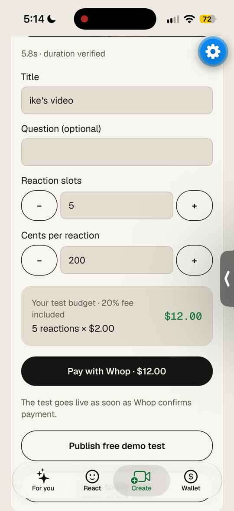<br><b>Brand posts a clip</b><br>slots, price, pay with Whop</td>
<td align="center">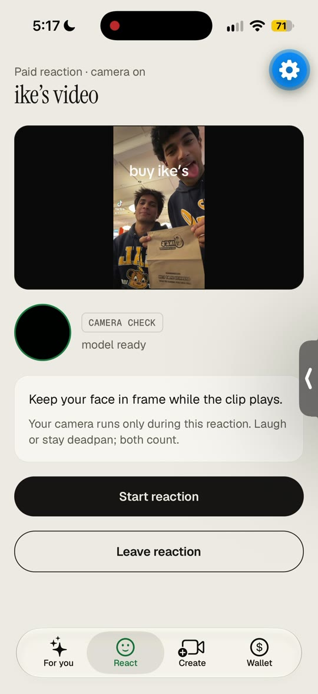<br><b>Student reacts</b><br>camera on, face verified</td>
<td align="center">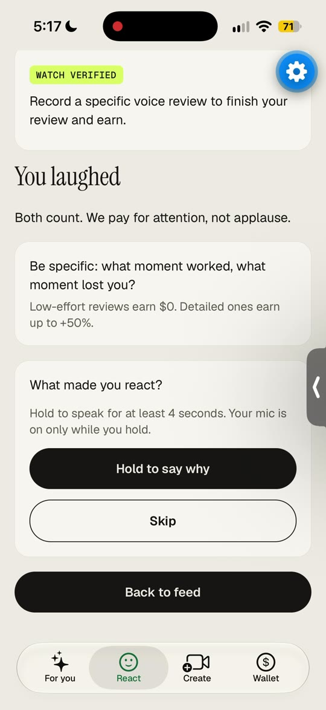<br><b>"You laughed"</b><br>then hold to say why</td>
<td align="center">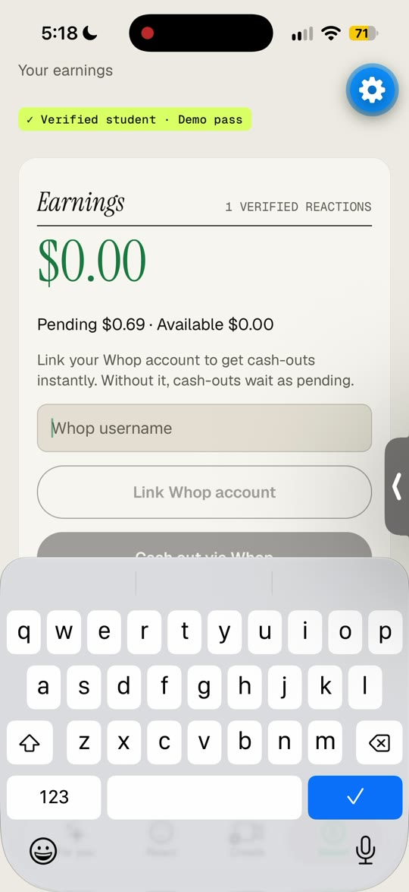<br><b>Wallet</b><br>pending, cap, reviewer score</td>
</tr>
<tr>
<td align="center">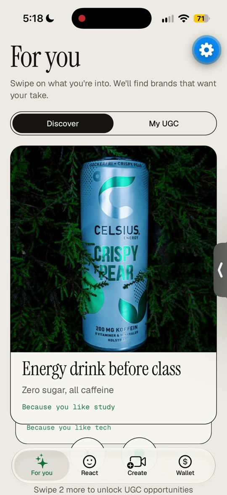<br><b>For you</b><br>a deck that learns your taste</td>
<td align="center">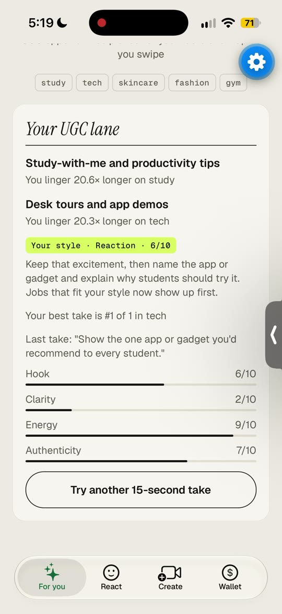<br><b>Your UGC lane</b><br>15s take, AI scores it</td>
<td align="center">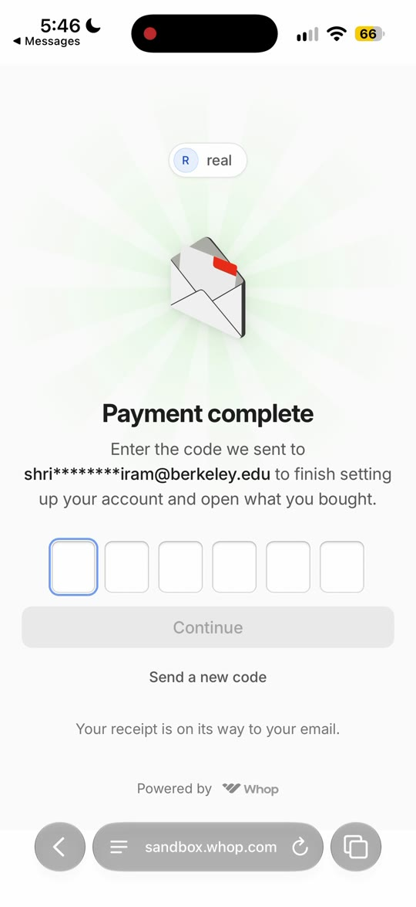<br><b>Whop checkout</b><br>started from an iMessage</td>
<td></td>
</tr>
</table>

## Why people open it every day

- **Fresh paid clips land daily.** Watch a 15-second clip, react, get paid. Under a minute.
- **A For you deck that learns you** from swipes and watch time, then unlocks paid UGC jobs that fit your style.
- **A wallet that moves:** pending turns into available, your reviewer score climbs, cash out any time.
- **A calm daily cap** ($25/day, 3 minutes between paid reactions) makes it a ritual, not a grind.
- **Brands come back daily too:** every reaction updates their live curve, and A/B tells them which cut to post today.

## How it works

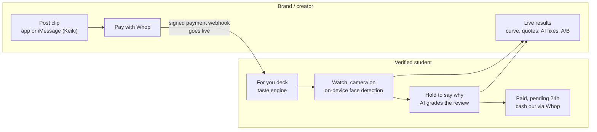

1. **Brand posts a clip**, asks one question, picks slots and price, and pays with **Whop**. It goes live the moment Whop's signed webhook arrives.
2. **A verified student** (`.edu` code, or the judges' demo pass `yc2026`) watches with the front camera on. **On-device MediaPipe face detection** proves a human watched and draws a second-by-second laugh curve. No face video leaves the phone.
3. **They hold to talk and say why.** AI extracts a verbatim quote, *what worked*, *what sucked*, and grades how specific it is.
4. **The brand sees the truth:** reaction curve, quotes, an AI "what to fix" report, who it landed with, and **A/B compare**.

## Built so you can't farm it

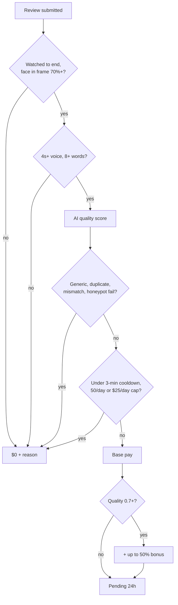

- **Laugh or stay deadpan, both get paid.** We never reward faking it.
- **A laugh only counts if it's sustained** (1.5s+ on a smoothed curve), recomputed on the server.
- **"It was good" earns $0.** Specific, moment-level feedback earns up to +50%.
- **Trust score** per student. Brands can mark a review "not helpful" and claw back pending pay (max 3 per test).
- **If our AI fails, students still get base pay.** Low-effort reviews never do.

## Whop is the whole economy

| Direction | What happens |
|---|---|
| Money in | Brands fund reaction tests through a Whop checkout created per test, with the test's ID in the payment metadata |
| Money in | Brands fund paid UGC jobs through a second Whop checkout |
| Go-live | A test only goes live when Whop's signed `payment.succeeded` webhook verifies. No payment, no test |
| Money out | Students link a Whop account and cash out as Whop transfers. Failed transfers return to their balance |
| Trust | 24h pending hold before earnings become available, so brands can claw back unhelpful reviews |

## Keiki: no app needed

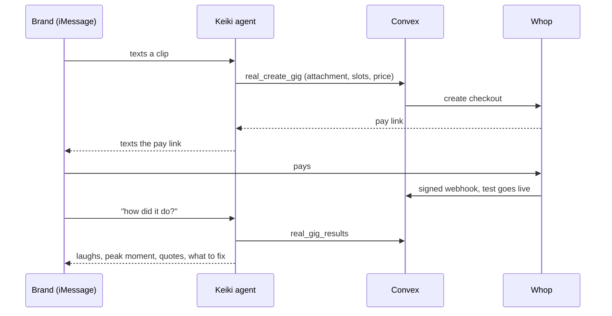

Custom tools (`real_create_gig`, `real_creator_status`, `real_gig_results`) call secret-gated Convex HTTP actions (`/keiki/*`). iMessage video attachments are fetched safely through redirects before becoming a test.

## Architecture

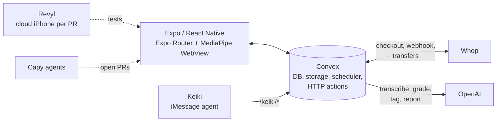

| Layer | Tech |
|---|---|
| App | Expo SDK 58, Expo Router, React Native, MediaPipe Face Landmarker in a WebView |
| Backend | Convex (queries, mutations, actions, file storage, scheduled jobs, HTTP actions) |
| Payments | Whop (checkout, signed webhooks, cash-out transfers) |
| Messaging | Keiki iMessage agent with custom tools |
| AI | OpenAI (transcription, review grading, tags, "what to fix", creator take scoring) |
| Quality | Revyl preview build + E2E test on every PR |
| Velocity | Capy parallel coding agents, 50+ PRs merged in one day |

## Sponsors

| Sponsor | What it does here |
|---|---|
| **Convex** | Everything: data, live results, taste engine, verification codes, scheduled AI jobs, Whop and Keiki endpoints |
| **Whop** | Both sides of the money: checkout in, cash-out out, webhook-verified go-live |
| **Keiki** | Brands run the whole flow from iMessage: post a clip, pay, get results texted back |
| **Revyl** | Every PR built and tested on a cloud iPhone with Proof of Changes |
| **Capy** | Parallel agents shipped the For you deck, UGC lane, creator ranking and more |
| **OpenAI** | Voice transcription, feedback grading, tagging, reports |

## Run it

```bash
cd app
npm install
npx convex dev            # backend (writes .env.local)
npx expo start --tunnel   # scan the QR with Expo Go
```

Convex env vars (`WHOP_API_KEY`, `WHOP_COMPANY_ID`, `WHOP_WEBHOOK_SECRET`, `OPENAI_API_KEY`, `GMAIL_USER`, `GMAIL_APP_PASSWORD`, `KEIKI_TOOL_SECRET`, optional `DEMO_PASS`, `DEMO_INSTANT_RELEASE`) are listed in [`docs/ENV.md`](docs/ENV.md). Secrets never go in the app.

**Judges:** tap "Judging the demo? No .edu needed" and enter `yc2026`.

## Challenges we hit

- Face detection fully on-device inside Expo Go, scored every frame.
- Whop sandbox: the API key and business ID must come from the same business, plan titles max 30 chars, and signed webhooks need exact verification.
- Keiki: one phone number binds to one agent, and attachments arrive as IDs that need fetching.
- Making REAL hard to farm without being unfair to honest students.

## Docs

[`docs/TASKS.md`](docs/TASKS.md) build plan and API contract · [`AGENTS.md`](AGENTS.md) agent rules · [`docs/COMMANDS.md`](docs/COMMANDS.md) · [`docs/ENV.md`](docs/ENV.md) · [`docs/REVYL_SETUP.md`](docs/REVYL_SETUP.md)
